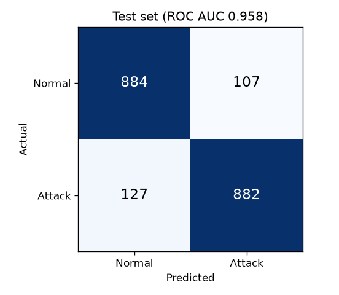
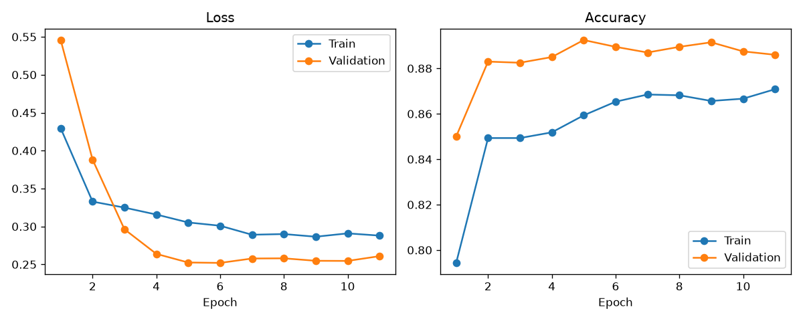
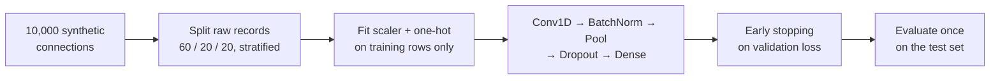

<picture>
  <source media="(prefers-color-scheme: dark)" srcset="assets/banner-dark.svg">
  
</picture>

<p align="center">
  <a href="https://github.com/ashwinpr15/network-security-analytics/actions/workflows/ci.yml"></a>
  
  
  
  <a href="LICENSE"></a>
</p>

A small intrusion-detection pipeline: generate network connection records with NSL-KDD-style fields, preprocess them without leaking test data, and classify each connection as **normal** or **attack** with a 1D convolutional network.

## Results

From `python train.py` on 10,000 records (6,000 train / 2,000 validation / 2,000 test, seed 42):

| Model | Test accuracy | ROC AUC |
|---|:---:|:---:|
| Conv1D network | 88.3% | 0.958 |
| Logistic regression baseline | **89.4%** | **0.966** |

<p align="center">
  
  
</p>

Training stops early after 11 epochs, and the best weights (epoch 6) are restored.

### The baseline wins, and that's useful to know

A plain logistic regression slightly beats the CNN. That isn't a failure of the experiment, it's the point of including a baseline: the attack label here comes from a mostly linear rule (SYN-error rate, connection count, large transfers and the `S0` flag), so a linear model already captures it. A convolution over a row of tabular features also has no real notion of "neighbouring" columns. On real traffic with sequences and interactions, the comparison could easily go the other way, which is why you test it rather than assume it.

## How it works



- **`src/data_utils.py`** generates eight numeric fields (duration, bytes, error rates, counts) and three categorical ones (protocol, service, TCP flag), then labels each record with a noisy risk rule. `preprocess_data()` fits MinMax scaling and one-hot encoding on training data only, and reuses them for validation and test. Unseen categories are ignored rather than crashing.
- **`src/model.py`** is the network: 64 Conv1D filters, batch normalization, max pooling, 30% dropout, then a small dense head with a sigmoid output.
- **`train.py`** splits the raw records *before* any preprocessing, trains with early stopping on the validation set, touches the test set exactly once, and saves the model, preprocessor, metrics and charts.

### Avoiding leakage

Two easy mistakes are designed out: fitting the scaler on all the data (so test values shape the training features), and using the test set for early stopping (so the "held-out" score was really used for tuning). `test_evaluation.py` checks that held-out rows don't change the fitted scaler, that unseen categories are handled, and that the saved preprocessor gives identical output after reloading.

## Run it

```sh
python -m venv .venv
# Windows: .venv\Scripts\activate    macOS/Linux: source .venv/bin/activate
pip install -r requirements.txt
python train.py          # ~15 s on CPU
python -m unittest -v    # tests
```

Outputs: `models/ids_cnn_model.keras`, `models/preprocessor.joblib` (both ignored by git) and `results/` (metrics and charts). Only load model and joblib files you trust. Tested with Python 3.13, TensorFlow 2.21 and scikit-learn 1.9.

## Project layout

```
├── src/
│   ├── data_utils.py      # synthetic records and leak-free preprocessing
│   └── model.py           # Conv1D classifier
├── train.py               # split, train, evaluate, save
├── test_evaluation.py     # leakage and serialization tests
├── models/                # saved model and preprocessor (git-ignored)
└── results/               # metrics.json and charts from the last run
```

## Good to know

- **The traffic is synthetic.** Field names follow NSL-KDD, but the records and labels are generated, so these scores show the pipeline working, not real-world detection performance.
- **Next steps:** train and evaluate on the real NSL-KDD dataset with its separate test file, compare against gradient-boosted trees, report per-attack-type recall, and tune the decision threshold for the false-alarm rate a security team can live with.

## License

[MIT](LICENSE)
